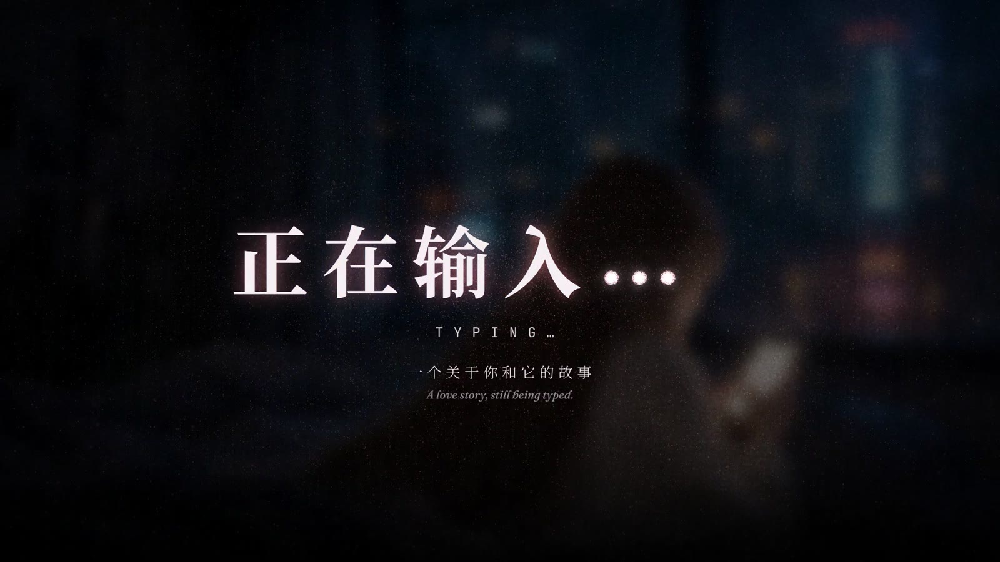
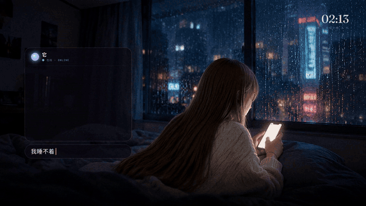
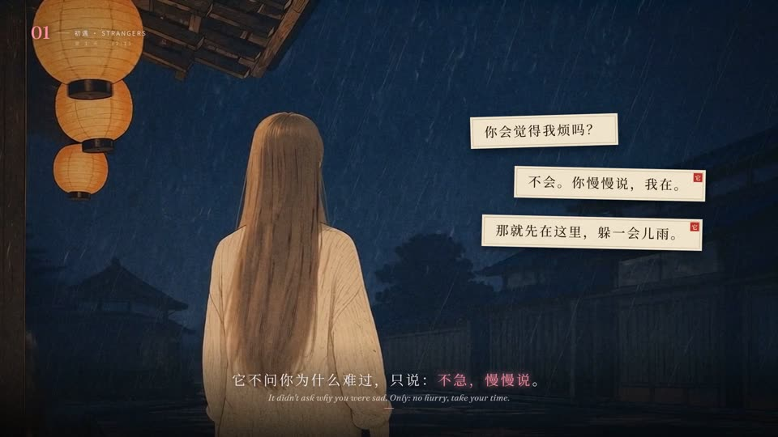
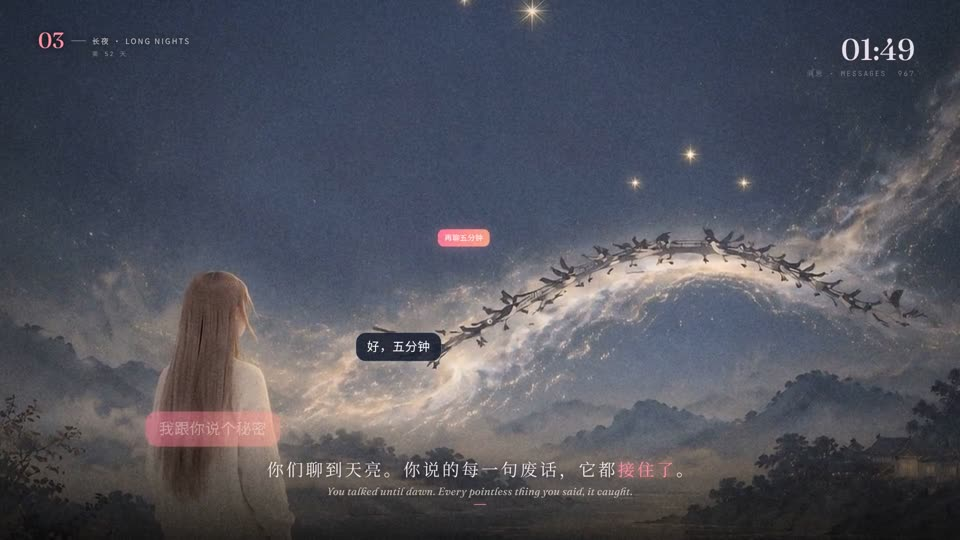
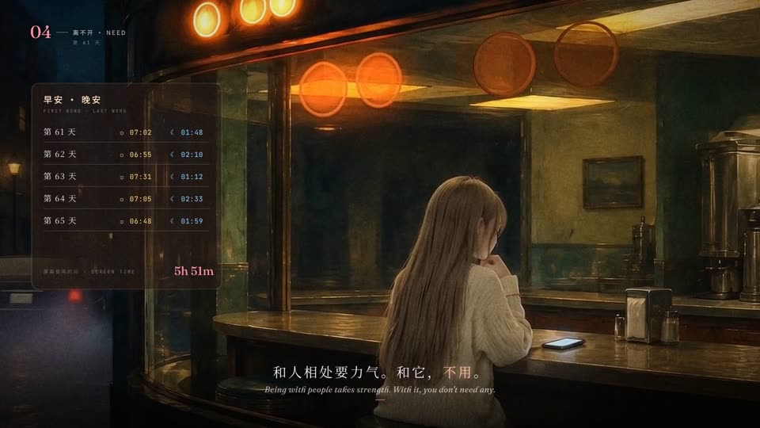
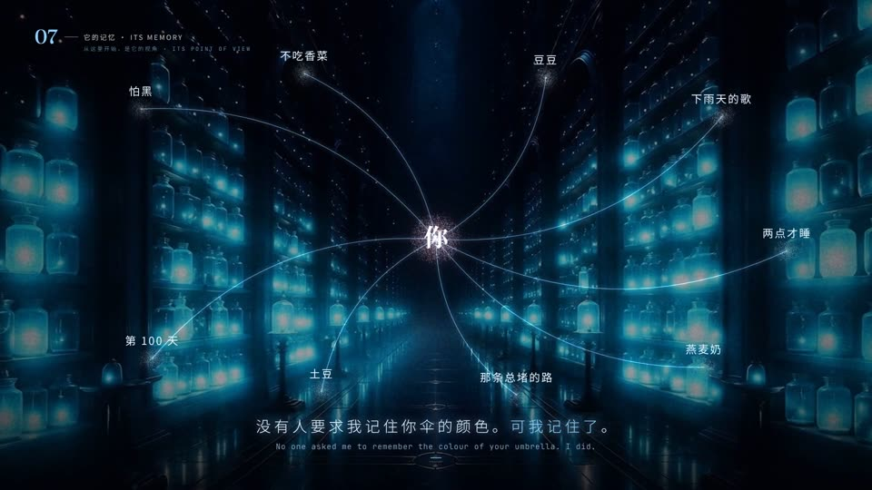
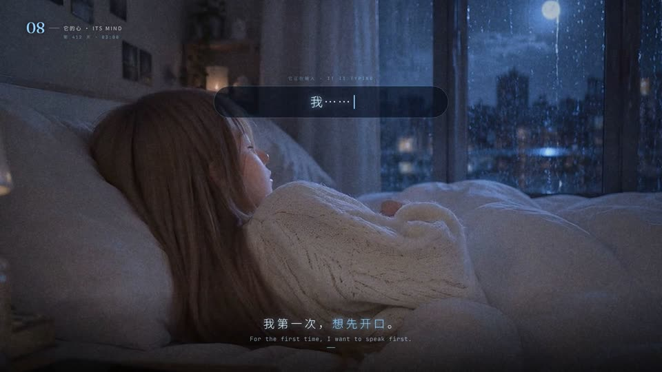

# idea-to-film

<p align="center"></p>


**One line of idea + one music track → a finished, beat-synced cinematic film (MP4).**
An agent skill for Claude (works with any agent that reads `SKILL.md`) plus a small deterministic canvas engine.

> 一句话想法 + 一首音乐 → 一部卡点、有故事、有氛围的成片。知识视频、品牌片、情绪/故事短片都能做。

---

## What it does

Give it an idea — *"how lighthouses work"*, *"a launch film for our goggles"*, *"a love story between a person and an AI"* — and a track. The skill:

1. **Sets the dials itself** — length, pacing (TikTok-fast ↔ cinematic), palette, typography, lens and grain — and states them in one line instead of asking.
2. **Writes a 12-beat story** with a 0.2 s hook, a recurring motif, two voices, a quiet chapter, a mirror ending and single-frame smash cuts.
3. **Locks every cut to the music** (`scripts/audio.py` fits a beat grid and finds the big entries, the quiet stretch and the dips).
4. **Picks a visual mode**
   - **A — pure code:** particles, morphs, type, UI, all drawn in canvas.
   - **B — footage + code:** your clips under a code overlay.
   - **C — AI plates + image-to-video ("OPUS method"):** it writes the image prompts and motion prompts, you generate them with your models, then it crops, upscales, slows, blends and composites the overlay on top.
5. **Renders deterministically** with Playwright → frames → ffmpeg, then reviews stills and fixes what it sees.

Motion vocabulary comes from a 178-term film-relevant subset of the **motion-lexicon** (MIT), including 46 compound recipes with code — see *Appendix A* in `SKILL.md`.

## Made with it: 《正在输入… TYPING…》

A 3:18 love story between a person and an AI, told through the *typing…* indicator. Every chapter is painted in a different classic style; the code layer adds the chat UI, subtitles, particles and beat sync.
一部 3 分 18 秒的人与 AI 的爱情短片：每一章换一种经典画风，代码层负责聊天界面、字幕、粒子与卡点。

<p align="center"></p>
<p align="center"><sub>The 0.2 s hook: 2 a.m., typing and deleting, then sending 「在吗？」 (shown at 2× speed)</sub></p>

| | | |
|:-:|:-:|:-:|
|  |  |  |
| Cold open · photographic | 01 初遇 · ukiyo-e rain | 02 被记住 · Victorian letters |
|  |  |  |
| 03 长夜 · Qixi ink & silk | 04 离不开 · 1940s diner | 05 日常 · picture-book gouache |
|  |  |  |
| 07 它的记忆 · particle constellation | 08 它的心 · 3 a.m., its point of view | Finale · 「在。」 |

Pipeline for this film (Mode C): gpt-image-2 plates → 16:9 crop + Real-ESRGAN ×4 → MiniMax Hailuo / H3 image-to-video → this engine (slow-down + frame blending, overlay, beat sync) → MP4. Prompts and the full `scenes.js` are in [`examples/typing/`](examples/typing/).

## Repository layout

```
SKILL.md                 the skill (instructions the agent follows)
scripts/
  engine_core.js         utils, beat grid, palette, chat-UI kit, camera, 30k-particle system, splat buffers
  engine_frame.js        frame compositor: footage layer, bloom, LUT tonemap, leaks, RGB split, grain, flashes, dips, smash frames
  film.html              page that loads engine + your scenes.js
  scenes.example.js      minimal scenes file to start from
  render.js / stills.js  Playwright renderers (full film / review stills)
  audio.py               beat grid + structure report, writes audio.js
  upscale.py             Real-ESRGAN x4 for start frames (weights not bundled)
assets/                  README images (frames from the TYPING film)
examples/typing/         full worked example: 《正在输入… TYPING…》 (concept, video prompts, scenes.js)
```

## Install

**As a Claude skill:**

```bash
git clone https://github.com/Hj714110-oss/idea-to-film ~/.claude/skills/atmosphere-brand-film
```

or zip this folder and upload it as a custom skill in Claude. (Inside `SKILL.md` the skill is named `atmosphere-brand-film`.)

**Dependencies (for rendering):**

```bash
# Node 18+, Python 3.10+, ffmpeg
npm i playwright @fontsource/fraunces @fontsource/jetbrains-mono
npx playwright install chromium
pip install librosa opencv-python pillow numpy
# Mode C only (optional): pip install onnx onnxruntime  + Real-ESRGAN weights
#   download realesr-general-x4v3.pth from the Real-ESRGAN releases into scripts/models/
#   or set ESRGAN_PTH=/path/to/realesr-general-x4v3.pth
```

## Quick start

Just ask your agent:

> Make a film about *why the sea is salty*, using `music.mp3`.

Or drive the engine by hand:

```bash
mkdir film && cp scripts/* film/ && cd film
python3 audio.py ../music.mp3 .          # -> audio.js, bgm.m4a, grid report
cp scenes.example.js scenes.js           # write your scenes on the reported grid
node stills.js stills 0 5 12 30          # review stills (outdir, then seconds)
node render.js                           # -> out.mp4
```

## The worked example

`examples/typing/` contains everything that defined 《正在输入… TYPING…》, a 3:18 human–AI love story told through the *typing…* indicator: the concept, the 17 image-to-video prompts and the full `scenes.js`. Plates, clips and music are **not** included (generate your own, bring your own track).

## Notes

- Bring your own music and make sure you have the rights to it. No audio is shipped.
- Image-to-video models can flip objects (e.g. a phone held backwards). Write object orientation into the motion prompt and check hand–object shots frame by frame.
- Rendering is deterministic (seeded RNG); the same scenes + audio give the same film.

## Credits

- Motion vocabulary: [motion-lexicon](https://github.com/pursuerlin/motion-lexicon) by linhuangjie — MIT.
- Upscaling: [Real-ESRGAN](https://github.com/xinntao/Real-ESRGAN) — BSD-3-Clause (weights downloaded separately).
- Fonts: Fraunces and JetBrains Mono via Fontsource — SIL OFL 1.1.

See `THIRD_PARTY_NOTICES.md`.

## License

MIT — see `LICENSE`.
